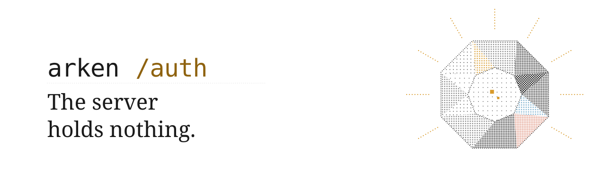
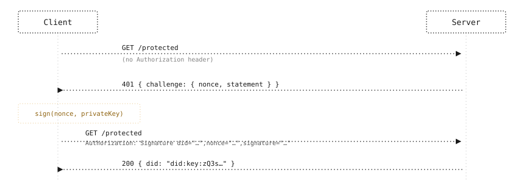
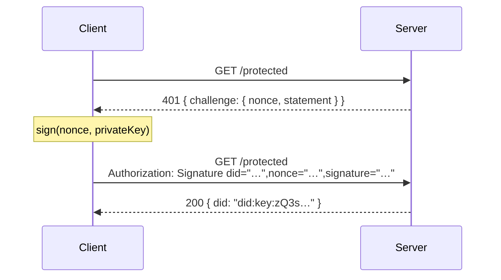
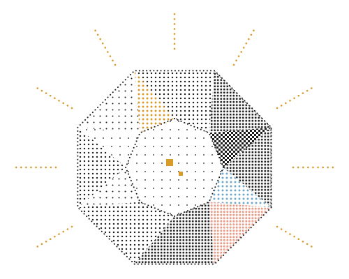

<p align="center">
  <picture>
    <source media="(prefers-color-scheme: dark)" srcset=".github/assets/arken-banner-dark.svg">
    
  </picture>
</p>

<p align="center">
  Cryptographic identity for AI agents. No API keys, no passwords, no user database to breach.
</p>

<p align="center">
  <a href="https://www.npmjs.com/package/@arkenforge/arken-auth"></a>
  <a href="https://opensource.org/licenses/MIT"></a>
  <a href="https://github.com/ArkenForge/arken-protocol/actions/workflows/release.yml"></a>
</p>

<p align="center">
  <a href="#install">Install</a> ·
  <a href="#how-it-works">How it works</a> ·
  <a href="#status-and-limits">Limits</a> ·
  <a href="#join-the-10-waitlist">Join the 1.0 waitlist</a>
</p>

---

## Protect a route with one line of middleware

```js
const express = require('express');
const { arkenAuth } = require('@arkenforge/arken-auth');

const app = express();

app.get('/protected', arkenAuth(), (req, res) => {
  res.json({ did: req.user.did });
});
```

An unsigned request gets a `401` back with a one-time nonce. The client signs the nonce with its private key and retries with an `Authorization: Signature` header. The middleware verifies the signature cryptographically and sets `req.user.did` — no database lookup, no session, nothing stored.

---

## Install

```bash
npm install @arkenforge/arken-auth
```

```bash
pip install arken-auth
```

> [!NOTE]
> **Requires a Rust toolchain today.** The postinstall script compiles the native crypto library.
> Install Rust from [rustup.rs](https://rustup.rs), then re-run the install.
> **Prebuilt binaries ship with 1.0** — no Rust required after that.

---

## Quickstart

<details>
<summary><strong>Express (Node.js)</strong></summary>

**Server**

```js
// server.js
const express = require('express');
const { arkenAuth } = require('@arkenforge/arken-auth');

const app = express();

app.get('/protected', arkenAuth(), (req, res) => {
  res.json({ message: 'Authenticated', did: req.user.did });
});

app.listen(3000);
```

Options:

```js
arkenAuth({
  statement: 'Sign to access the API.' // shown to the user during signing; optional
})
```

**Client**

```js
// client.js
const { ethers } = require('ethers');
const bs58 = require('bs58');

function walletToDidKey(wallet) {
  const signingKey = new ethers.utils.SigningKey(wallet.privateKey);
  const keyBytes = Buffer.from(signingKey.compressedPublicKey.slice(2), 'hex');
  const multicodecKey = Buffer.concat([Buffer.from([0xe7, 0x01]), keyBytes]);
  return `did:key:z${bs58.encode(multicodecKey)}`;
}

async function authenticate(url) {
  const wallet = ethers.Wallet.createRandom();
  const did = walletToDidKey(wallet);

  // 1. Get the challenge
  const r1 = await fetch(url);
  const { challenge } = await r1.json(); // 401
  const { nonce } = challenge;

  // 2. Sign the nonce
  const signature = await wallet.signMessage(ethers.utils.toUtf8Bytes(nonce));

  // 3. Send the signed header
  const r2 = await fetch(url, {
    headers: {
      Authorization: `Signature did="${did}",nonce="${nonce}",signature="${signature}"`
    }
  });

  return r2.json(); // { did: "did:key:zQ3s…" }
}
```

</details>

<details>
<summary><strong>FastAPI (Python)</strong></summary>

**Server**

```python
# server.py
from fastapi import FastAPI, Depends
from fastapi.responses import JSONResponse
from arken_auth import ArkenAuth

app = FastAPI()

@app.get("/protected")
async def protected(did: str = Depends(ArkenAuth())):
    return {"message": "Authenticated", "did": did}

# Return 401 challenge as JSON (FastAPI raises plain text by default)
@app.exception_handler(401)
async def auth_exception_handler(request, exc):
    if hasattr(exc, "detail") and isinstance(exc.detail, dict):
        return JSONResponse(
            status_code=401,
            content=exc.detail,
            headers=getattr(exc, "headers", {}),
        )
    return JSONResponse(status_code=401, content={"detail": str(exc.detail)})
```

Options:

```python
ArkenAuth(statement="Sign to access the API.")  # optional
```

The dependency returns the authenticated `did` string. On failure it raises `HTTPException(401)` with `{ "challenge": { "nonce": "…", "statement": "…" } }` as the body.

</details>

---

## How it works

<p align="center">
  <picture>
    <source media="(prefers-color-scheme: dark)" srcset=".github/assets/arken-flow-dark.svg">
    
  </picture>
</p>



**Challenge.** The server generates a random 32-character nonce, stores it in memory with a 60-second TTL, and returns it as JSON on `401`. Each nonce is single-use.

**Proof.** The client signs the nonce with its secp256k1 private key using `eth_sign` (the Ethereum personal sign scheme). The private key never leaves the client.

**Verify and forget.** The server uses ECDSA signature recovery (via [ethers-rs](https://github.com/gakonst/ethers-rs)) to derive the signer's address from the signature alone, then checks it matches the address encoded in the DID. No credentials are stored. The nonce is consumed.

---

## Why Arken

| | What it means |
|---|---|
| **No passwords** | Nothing to phish, crack, or reuse across sites |
| **No sessions** | No cookies, no JWTs, no server-side token store |
| **No user database** | Nothing to breach; the server forgets after each request |
| **No per-site accounts** | One key authenticates to any server running Arken |
| **No lock-in** | The DID format is a W3C open standard |

<p align="right">
  <picture>
    <source media="(prefers-color-scheme: dark)" srcset=".github/assets/arken-stone-dark.svg">
    
  </picture>
</p>

---

## Identity: `did:key`

Identity in Arken is a [W3C DID Key](https://w3c-ccg.github.io/did-method-key/) identifier — a self-describing string derived from a public key:

```
did:key:zQ3shXgnkuyqVxf3NGBsK1q3J…
```

The `z` prefix is the [multibase](https://github.com/multiformats/multibase) indicator for base58btc encoding. Inside is the [multicodec](https://github.com/multiformats/multicodec) prefix `0xe7 0x01` (secp256k1-pub) followed by the 33-byte compressed public key.

> **Key type correction.** Earlier documentation showed `did:key:z6Mk…` which is the Ed25519 prefix. This project uses secp256k1 keys (`0xe7 0x01`), whose correct prefix is `zQ3s…`. The Rust verifier enforces this.

This identity is **portable**: it is not bound to a domain, a server, or an account. An agent with a `did:key` can authenticate to any server running Arken without registering anywhere.

---

## Status and limits

- **Not production-ready.** This is an early-stage project.
- **Nonces are in memory.** They do not survive restarts and will not work across multiple server instances without a shared store.
- **No key recovery.** For services, plan for key rotation. Losing the private key means losing access.
- **Rust toolchain required to install.** Prebuilt binaries are on the 1.0 roadmap.
- **Aimed at APIs, developer tools, and server-to-server auth** — not consumer apps where key management is a burden.

---

## Roadmap to 1.0

- [x] Prebuilt binaries (no Rust required to install)
- [x] Shared nonce store (Redis adapter)
- [ ] Key rotation
- [x] `arken-client` package (wraps the two-step fetch automatically)
- [ ] `did:web` and `did:pkh` support
<!-- TODO: add any further roadmap items from open issues -->

---

## Security and the Dragon Hunt

See [SECURITY.md](SECURITY.md) for the reporting process and scope.

Find a flaw, open a private advisory, and your name goes in the Hall of Finders.

---

## Join the 1.0 waitlist

**Founding Builders** — everyone who joins before December 15, 2026 — are credited by name in the 1.0 README.

There are **10 design-partner slots** for teams who want to shape the 1.0 API directly.

<!-- TODO: replace with beehiiv URL when available -->
[Join the waitlist](https://tally.so/r/kbbjWR)

---

## Contributing

- Open an issue before starting significant work — alignment up front saves effort.
- Run the existing tests before submitting a pull request.
- Keep the core small: the crypto layer is intentionally minimal.

---

## License

[MIT](LICENSE) — ArkenForge
