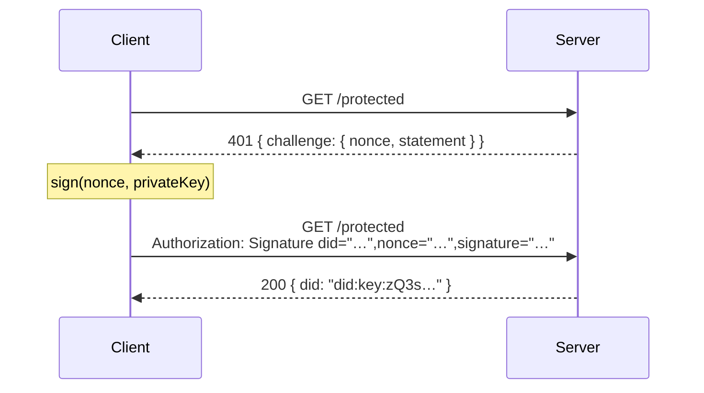

<p align="center">
  <picture>
    <source media="(prefers-color-scheme: dark)" srcset=".github/assets/arken-banner-dark.svg">
    
  </picture>
</p>

<p align="center">
  The cryptographic core of ArkenForge. ECDSA signature verification, <code>did:key</code> identity, nonce generation.
</p>

<p align="center">
  <a href="https://opensource.org/licenses/Apache-2.0"></a>
  <a href="https://github.com/ArkenForge/arken-core/actions/workflows/release.yml"></a>
</p>

---

## What this is

`arken-core` is the Rust library that everything in ArkenForge builds on. It handles:

- **Challenge generation** — cryptographically random nonces with 60s TTL
- **Signature verification** — ECDSA secp256k1 via [ethers-rs](https://github.com/gakonst/ethers-rs)
- **DID parsing** — `did:key` identity using the W3C spec (`zQ3s…` prefix for secp256k1)

It compiles to a native shared library (`.dylib` / `.so` / `.dll`) loaded by higher-level packages via FFI.

## Build

Requires [Rust](https://rustup.rs).

```bash
cd rust
cargo build --release
```

Output: `rust/target/release/libarken_core.{dylib,so,dll}`

## C API

Three C-compatible functions are exported:

```c
int generate_challenge_into(const char *statement, char *out, int cap);
int verify_request_into(const char *header, char *out, int cap);
int verify_signature_only_into(const char *header, char *out, int cap);
```

All functions write JSON into `out` and return the number of bytes written, or `-1` on buffer overflow.

## How it works

An unsigned request gets a `401` with a one-time nonce. The client signs the nonce with its secp256k1 private key and retries with an `Authorization: Signature` header. The core verifies the ECDSA signature, checks the nonce, and returns the agent's `did:key` — nothing stored, nothing breached.



## Identity: `did:key`

Each agent gets a [W3C DID Key](https://w3c-ccg.github.io/did-method-key/) derived from its key pair:

```
did:key:zQ3shXgnkuyqVxf3NGBsK1q3J…
```

The `zQ3s…` prefix indicates secp256k1 (`0xe7 0x01` multicodec). Same key, same DID, across every server running Arken. One identity, every tool.

## ArkenForge ecosystem

| Repo | What it is |
|---|---|
| **arken-core** (this repo) | Rust crypto core — the foundation |
| [arken-auth](https://github.com/arkenforge/arken-auth) | Express + FastAPI middleware, client SDKs, MCP integration |
| [arken-registry](https://github.com/arkenforge/arken-registry) | Discovery registry — find APIs that accept Arken auth |
| [arken-verifier](https://github.com/arkenforge/arken-verifier) | Hosted verifier — metered signature verification |

## Status

- **Not production-ready.** Early-stage project.
- **Nonces are in memory.** Won't survive restarts or work across multiple instances without a shared store.
- **No key recovery.** Losing the private key means losing access.
- **Rust toolchain required to build.** Prebuilt binaries are on the 1.0 roadmap.

## Security

See [SECURITY.md](SECURITY.md). Find a flaw, open a private advisory, and your name goes in the Hall of Finders.

## Join the 1.0 waitlist

**Founding Builders** — everyone who joins before December 15, 2026 — are credited by name in the 1.0 README. There are **10 design-partner slots** for teams who want to shape the API directly.

[Join the waitlist](https://tally.so/r/kbbjWR)

## License

[Apache 2.0](LICENSE) — ArkenForge
